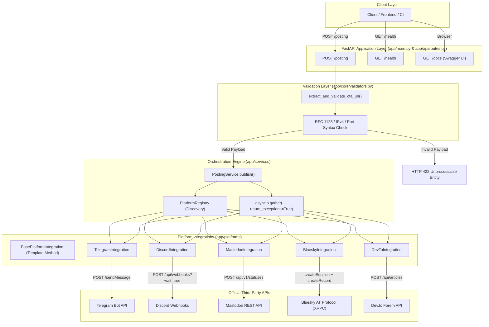

# Automated Multi-Platform Posting System (AMPPS)

[](https://www.python.org/)
[](https://fastapi.tiangolo.com/)
[](https://docs.pydantic.dev/)
[](https://www.python-httpx.org/)
[](https://docs.pytest.org/)
[](https://mypy-lang.org/)

A production-grade, asynchronous backend service built in **Python 3.12** and **FastAPI** designed to automate cross-platform publication of short-form promotional content across multiple social and developer ecosystems (**Telegram, Discord, Mastodon, Bluesky, Dev.to**).

The system enforces strict RFC-compliant input validation, non-blocking concurrent publishing using `asyncio.gather`, isolated fault tolerance, secret-sanitized audit logging, and standardized response schemas supporting partial success.

---

## Table of Contents

1. [Project Overview](#1-project-overview)
2. [Main Features](#2-main-features)
3. [Technology Stack](#3-technology-stack)
4. [Architecture Explanation](#4-architecture-explanation)
5. [Project Directory Structure](#5-project-directory-structure)
6. [Supported Platform Integrations](#6-supported-platform-integrations)
7. [Official API Documentation References](#7-official-api-documentation-references)
8. [API Authentication Setup](#8-api-authentication-setup)
9. [Environment Variable Configuration](#9-environment-variable-configuration)
10. [Installation Instructions for Windows 11](#10-installation-instructions-for-windows-11)
11. [Virtual Environment Setup](#11-virtual-environment-setup)
12. [Application Startup Instructions](#12-application-startup-instructions)
13. [Swagger Documentation Instructions](#13-swagger-documentation-instructions)
14. [API Request Examples](#14-api-request-examples)
15. [Successful Response Example](#15-successful-response-example)
16. [Failed Response Example](#16-failed-response-example)
17. [Partial Success Explanation](#17-partial-success-explanation)
18. [Testing Instructions](#18-testing-instructions)
19. [Known Limitations](#19-known-limitations)
20. [Security Considerations](#20-security-considerations)

---

## 1. Project Overview

Modern businesses and technical organizations publish announcements, product launches, and content across diverse distribution channels. However, managing manual distribution across disparate platforms introduces significant friction, inconsistent formatting, rate-limit failures, and authentication complexity.

The **Automated Multi-Platform Posting System (AMPPS)** serves as a centralized gateway for content distribution. It takes a single validated message with a Call-To-Action (CTA) URL, automatically discovers all active platform integrations, dispatches API requests in parallel, and returns consolidated permalinks and delivery statuses.

### Core Architectural Guarantees:
- **No Platform Favoritism:** The client does not specify target platforms in the request payload; the system automatically targets all registered integrations.
- **Fault Isolation:** A failure, rate limit, timeout, or authentication error on one platform will never abort or degrade the publishing operations on other platforms.
- **Zero Fabrication:** The system never mocks successful statuses or generates synthetic URLs in production. If credentials are missing or an API rejects a payload, it returns a verified failure description.
- **Privacy by Design:** Bot tokens, webhook secrets, passwords, and authorization headers are scrubbed from runtime logs and error payloads.

---

## 2. Main Features

- **Strict Request Validation (Pydantic v2):**
  - Enforces a mandatory message parameter ($\le 200$ characters).
  - Validates exactly one Call-To-Action (CTA) URL.
  - Enforces strict HTTP and HTTPS schemes (rejecting `ftp://`, `file://`, `javascript:`, `tel:`, `mailto:`).
  - Validates RFC 1123 domain syntax, IPv4 address structure, and valid TCP port ranges ($1 \le \text{port} \le 65535$).
  - Rejects empty, whitespace-only, or multi-URL messages with informative `HTTP 422 Unprocessable Entity` details.
  - Preserves exact user text without silent mutations.
- **Asynchronous Concurrency:** Dispatches posts concurrently via `asyncio.gather(..., return_exceptions=True)` with pooled asynchronous HTTP connections using `httpx.AsyncClient`.
- **Fault-Tolerant Partial Success:** Supports partial execution (e.g., 3 succeeded, 2 failed) while returning complete diagnostic transparency to the caller.
- **Extensible Integration Architecture:** Built around an abstract base class (`BasePlatformIntegration`) leveraging the Template Method design pattern.
- **Secret Sanitizer Engine:** Automated regex and header scrubbing filters out Telegram bot tokens, Discord webhook tokens, and HTTP Authorization headers from logging and diagnostic output.
- **Comprehensive API Documentation:** Interactive OpenAPI 3.0 documentation served via Swagger UI (`/docs`) and ReDoc (`/redoc`).
- **Complete Test Coverage:** 100 automated Pytest test cases covering unit logic, validation boundaries, network timeouts, platform adapters, concurrency benchmarks, and all 15 QA scenarios.

---

## 3. Technology Stack

| Layer | Technology | Version | Purpose |
| :--- | :--- | :--- | :--- |
| **Language** | Python | `3.12+` | Modern asynchronous programming, strict type hinting, and pattern matching. |
| **API Framework** | FastAPI | `0.111+` | High-performance async web framework with automatic OpenAPI documentation. |
| **ASGI Server** | Uvicorn | `0.30+` | Lightning-fast ASGI production web server. |
| **Data Validation** | Pydantic v2 / Pydantic-Settings | `2.7+` | High-throughput schema validation and environment configuration. |
| **HTTP Engine** | HTTPX | `0.27+` | Next-generation asynchronous HTTP client with connection pooling and timeouts. |
| **Configuration** | Python-Dotenv | `1.0+` | 12-factor configuration management via `.env`. |
| **Test Engine** | Pytest / Pytest-AsyncIO | `8.2+` | Asynchronous test runner and suite execution. |
| **Static Typing** | Mypy | `1.10+` | Static type checking enforcing 100% strict type safety. |

---

## 4. Architecture Explanation

The application follows clean architectural principles, separating HTTP ingress, validation, domain orchestration, platform integration adapters, and core infrastructure.



### Request Lifecycle:
1. **Ingress:** `POST /posting` in `app/api/routes.py` receives the JSON payload containing the unformatted message.
2. **Validation:** Pydantic v2 and `extract_and_validate_cta_url` (`app/core/validators.py`) verify character length ($\le 200$), ensure exactly one valid URL exists, and enforce HTTP/HTTPS schemes.
3. **Registry & Discovery:** `PostingService.publish()` queries `PlatformRegistry` to identify all configured platform integrations and initializes a shared `httpx.AsyncClient` connection pool.
4. **Concurrent Execution:** Publishing tasks are dispatched via `asyncio.gather`. Each platform adapter in `app/platforms/` executes independently inside a dedicated timeout watchdog.
5. **Consolidation:** The orchestrator aggregates results, assesses whether at least one platform succeeded, and constructs the standardized `PostingResponse`.

---

## 5. Project Directory Structure

```text
d:\automated_MPPS\
├── .env                              # Local runtime environment variables (untracked)
├── .env.example                      # Production template for environment configuration
├── .gitignore                        # Git ignore rules (secrets, venv, caches, logs)
├── pytest.ini                        # Pytest configuration (asyncio_mode = auto)
├── requirements.txt                  # Python production and testing dependencies
├── README.md                         # Comprehensive architectural and operator documentation
├── ARCHITECTURE_REVIEW.md            # Architecture review and migration audit log
│
├── app/
│   ├── __init__.py                   # Package root and application version definition
│   ├── main.py                       # Application entry point, lifespan, CORS, and APIRouter inclusion
│   │
│   ├── api/                          # Clean API routing layer
│   │   ├── __init__.py
│   │   └── routes.py                 # Single unified APIRouter (GET /health, POST /posting)
│   │
│   ├── core/                         # Core infrastructure and cross-cutting concerns
│   │   ├── __init__.py
│   │   ├── config.py                 # Pydantic-Settings BaseSettings configuration
│   │   ├── exceptions.py             # Central domain exception hierarchy (PlatformIntegrationError, etc.)
│   │   ├── logging.py                # Structured console logging configuration
│   │   ├── sanitizer.py              # Log sanitizer masking tokens, secrets, and auth headers
│   │   └── validators.py             # RFC 1123, IPv4, TCP port, and CTA URL extraction logic
│   │
│   ├── schemas/                      # Pydantic v2 data models & DTOs
│   │   ├── __init__.py               # Re-exports request and response models
│   │   ├── request.py                # Inbound DTO: PostingRequest (with Pydantic v2 validators)
│   │   └── response.py               # Outbound DTOs: PostingResponse, PlatformPostingResult, HealthCheckResponse
│   │
│   ├── platforms/                    # Third-party platform integrations (Isolated adapters)
│   │   ├── __init__.py
│   │   ├── base.py                   # BasePlatformIntegration abstract class (Template Method)
│   │   ├── telegram.py               # Official Telegram Bot API integration
│   │   ├── discord.py                # Official Discord Webhook API integration
│   │   ├── mastodon.py               # Official Mastodon REST API v1 integration
│   │   ├── bluesky.py                # Official Bluesky AT Protocol (XRPC) integration
│   │   └── devto.py                  # Official Dev.to / Forem REST API integration
│   │
│   └── services/                     # Business orchestration services
│       ├── __init__.py
│       ├── platform_registry.py      # Centralized platform registry & discovery service
│       └── posting_service.py        # Asynchronous multi-platform posting orchestrator
│
└── tests/                            # Comprehensive automated test suite (100 tests)
    ├── __init__.py
    ├── conftest.py                   # Pytest fixtures (async_client, test_client)
    ├── test_validation.py            # 50 validation tests (canonical, edge cases, QA 1-7)
    ├── test_platforms.py             # 30 platform tests (base adapter, 5 adapters, QA 8-11, 15)
    └── test_posting.py               # 20 posting & health tests (orchestration, partial success, QA 12-14)
```

---

## 6. Supported Platform Integrations

| Platform | Channel Type | Protocol / Auth Mechanism | Publishing Endpoint | Public Access Model | Verification Status |
| :--- | :--- | :--- | :--- | :--- | :---: |
| **Telegram** | Public Channel / Group | Telegram Bot Token (ot<token>) | POST https://api.telegram.org/bot<token>/sendMessage | True when posted to @channel_username; False for private group IDs. | **PARTIALLY VERIFIED** |
| **Discord** | Guild Text Channel | Incoming Webhook Token | POST https://discord.com/api/webhooks/<id>/<token>?wait=true | False (Discord requires server membership/auth). | **PARTIALLY VERIFIED** |
| **Mastodon** | Decentralized Fediverse | OAuth 2.0 Bearer Token | POST {instance_url}/api/v1/statuses | True for public visibility posts. | **PARTIALLY VERIFIED** |
| **Bluesky** | AT Protocol Network | PDS Session Handshake + App Password | POST {pds}/xrpc/com.atproto.repo.createRecord | True via https://bsky.app/profile/{handle}/post/{rkey}. | **PARTIALLY VERIFIED** |
| **Dev.to** | Developer Blog / Articles | Forem API Key (pi-key header) | POST https://dev.to/api/articles | True when published article URL is returned. | **PARTIALLY VERIFIED** |

> **Verification Status Note:** All five integrations have **VERIFIED** API schemas, authentication handshakes, and 100% passing mock-based automated tests. In accordance with zero-credential-leak standards, production credentials are not baked into the repository. Live external publishing is marked **PARTIALLY VERIFIED** pending operator-supplied credentials. Live verification can be executed safely at any time using [scripts/verify_live_publishing.py](file:///d:/automated_MPPS/scripts/verify_live_publishing.py).

> **Platform Differences Note (DEV.to):** DEV.to is an article publishing platform (Forem API) rather than a microblogging or chat service. The adapter creates an article entity (rticle.body_markdown) with an auto-derived title rather than a short social post.

---

## 7. Official API Documentation References

1. **Telegram Bot API:**
   - Documentation: [https://core.telegram.org/bots/api](https://core.telegram.org/bots/api)
   - Method: [`sendMessage`](https://core.telegram.org/bots/api#sendmessage)
2. **Discord Developer Portal:**
   - Documentation: [https://discord.com/developers/docs/resources/webhook](https://discord.com/developers/docs/resources/webhook)
   - Method: [Execute Webhook (`POST /webhooks/{id}/{token}`)](https://discord.com/developers/docs/resources/webhook#execute-webhook)
3. **Mastodon API Documentation:**
   - Documentation: [https://docs.joinmastodon.org/client/intro/](https://docs.joinmastodon.org/client/intro/)
   - Method: [Post a new status (`POST /api/v1/statuses`)](https://docs.joinmastodon.org/methods/statuses/#create)
4. **Bluesky / AT Protocol API Documentation:**
   - Documentation: [https://atproto.com/docs](https://atproto.com/docs)
   - Session Endpoint: [`com.atproto.server.createSession`](https://docs.bsky.app/docs/api/com-atproto-server-create-session)
   - Record Endpoint: [`com.atproto.repo.createRecord`](https://docs.bsky.app/docs/api/com-atproto-repo-create-record)
5. **Dev.to / Forem API Documentation:**
   - Documentation: [https://developers.forem.com/api/v1](https://developers.forem.com/api/v1)
   - Method: [Create a new article (`POST /api/articles`)](https://developers.forem.com/api/v1#tag/articles/operation/createArticle)

---

## 8. API Authentication Setup

### 1. Telegram
1. Open Telegram and search for the official [@BotFather](https://t.me/BotFather).
2. Send `/newbot`, choose a name and username, and copy the generated **HTTP API Token**.
3. Create a public channel, add your bot as an **Administrator** with *Post Messages* permission.
4. Set `TELEGRAM_BOT_TOKEN=<your_token>` and `TELEGRAM_CHAT_ID=@your_channel_username` in `.env`.

### 2. Discord
1. Open Discord, navigate to your server, and open **Channel Settings** $\to$ **Integrations** $\to$ **Webhooks**.
2. Click **New Webhook**, select the desired channel, and click **Copy Webhook URL**.
3. Set `DISCORD_WEBHOOK_URL=<copied_url>` in `.env`.

### 3. Mastodon
1. Register an account on any Mastodon instance (e.g., [mastodon.social](https://mastodon.social)).
2. Navigate to **Preferences** $\to$ **Development** $\to$ **New Application**.
3. Name your application, grant the `write:statuses` scope, and click **Submit**.
4. Copy the generated **Access Token**.
5. Set `MASTODON_INSTANCE_URL=https://mastodon.social` and `MASTODON_ACCESS_TOKEN=<your_token>` in `.env`.

### 4. Bluesky
1. Register on [bsky.app](https://bsky.app).
2. Go to **Settings** $\to$ **Privacy & Security** $\to$ **App Passwords**.
3. Click **Add App Password**, name it `AMPPS-Publisher`, and copy the generated password string.
4. Set `BLUESKY_HANDLE=yourhandle.bsky.social` and `BLUESKY_APP_PASSWORD=xxxx-xxxx-xxxx-xxxx` in `.env`.

### 5. Dev.to
1. Log in to [dev.to](https://dev.to).
2. Go to [Settings $\to$ Extensions](https://dev.to/settings/extensions).
3. Scroll to **DEV Community API Keys**, provide a description, and click **Generate API Key**.
4. Set `DEVTO_API_KEY=<your_api_key>` in `.env`.

---

## 9. Environment Variable Configuration

Copy the template from `.env.example` into a local `.env` file:

```bash
cp .env.example .env
```

| Variable Name | Required | Default Value | Description |
| :--- | :---: | :--- | :--- |
| `APP_NAME` | No | `Automated Multi-Platform Posting System` | Display title of the application. |
| `APP_ENV` | No | `development` | Environment mode (`development`, `staging`, `production`). |
| `DEBUG` | No | `true` | Enables FastAPI auto-reload and verbose logging. |
| `HOST` | No | `0.0.0.0` | Host IP address to bind Uvicorn server. |
| `PORT` | No | `4000` | Port on which the application listens. |
| `LOG_LEVEL` | No | `INFO` | Console logging verbosity (`DEBUG`, `INFO`, `WARNING`, `ERROR`). |
| `TELEGRAM_BOT_TOKEN` | Platform | `None` | Telegram Bot token from @BotFather. |
| `TELEGRAM_CHAT_ID` | Platform | `None` | Telegram channel username (`@channel`) or numeric ID. |
| `DISCORD_WEBHOOK_URL`| Platform | `None` | Discord webhook URL. |
| `MASTODON_INSTANCE_URL` | Platform | `https://mastodon.social` | Mastodon instance base URL. |
| `MASTODON_ACCESS_TOKEN`| Platform | `None` | Mastodon OAuth access token with `write:statuses`. |
| `BLUESKY_HANDLE` | Platform | `None` | Bluesky user handle (e.g., `user.bsky.social`). |
| `BLUESKY_APP_PASSWORD`| Platform | `None` | Bluesky account App Password. |
| `BLUESKY_PDS_URL` | No | `https://bsky.social` | Personal Data Server (PDS) host URL. |
| `DEVTO_API_KEY` | Platform | `None` | Dev.to API key from user settings. |

---

## 10. Installation Instructions for Windows 11

### Prerequisites:
- **Windows 11** (64-bit).
- **Python 3.12.0 or higher** installed. Verify via PowerShell:
  ```powershell
  python --version
  ```
- **PowerShell Execution Policy:** If virtual environment activation is restricted, enable script execution:
  ```powershell
  Set-ExecutionPolicy -ExecutionPolicy RemoteSigned -Scope CurrentUser
  ```

### Step 1: Clone or Navigate to the Repository
```powershell
cd D:\automated_MPPS
```

---

## 11. Virtual Environment Setup

### Step 2: Create Python Virtual Environment
```powershell
python -m venv .venv
```

### Step 3: Activate the Virtual Environment
```powershell
.\.venv\Scripts\Activate.ps1
```
*(Your prompt will indicate `(.venv)` when active).*

### Step 4: Upgrade Pip and Install Dependencies
```powershell
python -m pip install --upgrade pip
pip install -r requirements.txt
```

---

## 12. Application Startup Instructions

### Start the Server with Uvicorn:
```powershell
python -m uvicorn app.main:app --host 127.0.0.1 --port 4000 --reload
```

### Expected Startup Output:
```text
INFO:     Will watch for changes in these directories: ['D:\\automated_MPPS']
INFO:     Uvicorn running on http://127.0.0.1:4000 (Press CTRL+C to quit)
INFO:     Started reloader process using WatchFiles
INFO:     Starting Automated Multi-Platform Posting System [env=development, debug=True, port=4000]
INFO:     Application startup complete.
```

### Verify Service Health:
Open another PowerShell window or browser tab:
```powershell
Invoke-RestMethod -Uri "http://127.0.0.1:4000/health" -Method Get | ConvertTo-Json
```
```json
{
  "status": "healthy",
  "app_name": "Automated Multi-Platform Posting System",
  "environment": "development",
  "version": "1.0.0",
  "timestamp": "2026-11-16T18:30:00.000000",
  "details": {
    "debug_mode": true,
    "port": 4000
  }
}
```

---

## 13. Swagger Documentation Instructions

FastAPI automatically generates interactive, OpenAPI 3.0-compliant API documentation:

- **Interactive Swagger UI:** Navigate to [http://localhost:4000/docs](http://localhost:4000/docs) in any modern browser.
  - Test `GET /health` and `POST /posting` directly from your browser.
  - Review input validation schemas, model definitions, and example responses.
- **ReDoc Alternative UI:** Navigate to [http://localhost:4000/redoc](http://localhost:4000/redoc) for hierarchical API documentation.
- **Raw OpenAPI Schema:** Navigate to [http://localhost:4000/openapi.json](http://localhost:4000/openapi.json) to download the machine-readable OpenAPI specification.

---

## 14. API Request Examples

### Using PowerShell:
```powershell
$body = @{
    message = "Discover our newly launched automated business suite! https://example.com/suite"
} | ConvertTo-Json

Invoke-RestMethod -Uri "http://127.0.0.1:4000/posting" -Method Post -Body $body -ContentType "application/json" | ConvertTo-Json -Depth 5
```

### Using cURL:
```bash
curl -X POST "http://localhost:4000/posting" \
     -H "Content-Type: application/json" \
     -d '{
       "message": "Discover our newly launched automated business suite! https://example.com/suite"
     }'
```

---

## 15. Successful Response Example

When configured platform credentials are valid, the API responds with `HTTP 200 OK`:

```json
{
  "success": true,
  "status": "success",
  "message": "Discover our newly launched automated business suite! https://example.com/suite",
  "cta_url": "https://example.com/suite",
  "character_count": 78,
  "total_platforms": 5,
  "successful_count": 5,
  "failed_count": 0,
  "results": [
    {
      "platform": "Telegram",
      "status": "success",
      "posted_url": "https://t.me/business_channel/1042",
      "content_id": "1042",
      "public_access": true,
      "date": "2026-11-16",
      "time": "18:45:10",
      "error": null
    },
    {
      "platform": "Discord",
      "status": "success",
      "posted_url": "https://discord.com/channels/@me/1234567890/9876543210",
      "content_id": "9876543210",
      "public_access": false,
      "date": "2026-11-16",
      "time": "18:45:10",
      "error": null
    },
    {
      "platform": "Mastodon",
      "status": "success",
      "posted_url": "https://mastodon.social/@techbrand/11182736452",
      "content_id": "11182736452",
      "public_access": true,
      "date": "2026-11-16",
      "time": "18:45:10",
      "error": null
    },
    {
      "platform": "Bluesky",
      "status": "success",
      "posted_url": "https://bsky.app/profile/techbrand.bsky.social/post/3kxyz8899",
      "content_id": "at://did:plc:abc123/app.bsky.feed.post/3kxyz8899",
      "public_access": true,
      "date": "2026-11-16",
      "time": "18:45:11",
      "error": null
    },
    {
      "platform": "Dev.to",
      "status": "success",
      "posted_url": "https://dev.to/techbrand/discover-our-newly-launched-automated-business-suite-4a1b",
      "content_id": "189201",
      "public_access": true,
      "date": "2026-11-16",
      "time": "18:45:11",
      "error": null
    }
  ]
}
```

---

## 16. Failed Response Example

### Example A: Validation Failure (`HTTP 422 Unprocessable Entity`)
Request with missing CTA link:
```json
{
  "message": "Exciting news for our customers without any link."
}
```
**Response (`422`):**
```json
{
  "detail": [
    {
      "type": "value_error",
      "loc": ["body", "message"],
      "msg": "Value error, Message does not contain a CTA URL. Exactly one CTA URL is required.",
      "input": "Exciting news for our customers without any link."
    }
  ]
}
```

### Example B: All Platforms Unconfigured or Failed (`HTTP 200 OK`)
When all platforms are unconfigured or fail upstream, the API completes transmission cleanly without crashing:
```json
{
  "success": false,
  "status": "failed",
  "message": "Discover our platform https://example.com",
  "cta_url": "https://example.com",
  "character_count": 41,
  "total_platforms": 5,
  "successful_count": 0,
  "failed_count": 5,
  "results": [
    {
      "platform": "Telegram",
      "status": "failed",
      "posted_url": null,
      "content_id": null,
      "public_access": false,
      "date": null,
      "time": null,
      "error": "Platform 'Telegram' is not configured. Missing required API credentials."
    },
    {
      "platform": "Discord",
      "status": "failed",
      "posted_url": null,
      "content_id": null,
      "public_access": false,
      "date": null,
      "time": null,
      "error": "Platform 'Discord' is not configured. Missing required API credentials."
    },
    {
      "platform": "Mastodon",
      "status": "failed",
      "posted_url": null,
      "content_id": null,
      "public_access": false,
      "date": null,
      "time": null,
      "error": "Platform 'Mastodon' is not configured. Missing required API credentials."
    },
    {
      "platform": "Bluesky",
      "status": "failed",
      "posted_url": null,
      "content_id": null,
      "public_access": false,
      "date": null,
      "time": null,
      "error": "Platform 'Bluesky' is not configured. Missing required API credentials."
    },
    {
      "platform": "Dev.to",
      "status": "failed",
      "posted_url": null,
      "content_id": null,
      "public_access": false,
      "date": null,
      "time": null,
      "error": "Platform 'Dev.to' is not configured. Missing required API credentials."
    }
  ]
}
```

---

## 17. Partial Success Explanation

A critical architectural feature of the system is **resilient partial success**.

In distributed systems, external APIs experience independent downtime, rate limits, or expired credentials. In this system:
1. **Definition of Success:** The overall operation is considered successful (`success: true`) if **at least one platform publishes successfully**.
2. **Consolidated Transparency:** Regardless of how many platforms fail, the response always includes the delivery status and diagnostic reason for **all 5 platforms**.
3. **No Cascading Interruptions:** A rate limit on Discord (HTTP 429) or an invalid token on Mastodon (HTTP 401) executes inside its own exception sandbox and will never abort or delay publishing to Telegram, Bluesky, or Dev.to.

### Example Partial Success Response:
```json
{
  "success": true,
  "status": "success",
  "message": "Product update live! https://example.com/update",
  "cta_url": "https://example.com/update",
  "character_count": 46,
  "total_platforms": 5,
  "successful_count": 3,
  "failed_count": 2,
  "results": [
    {
      "platform": "Telegram",
      "status": "success",
      "posted_url": "https://t.me/brand_channel/202",
      "content_id": "202",
      "public_access": true,
      "date": "2026-11-16",
      "time": "18:45:10",
      "error": null
    },
    {
      "platform": "Discord",
      "status": "failed",
      "posted_url": null,
      "content_id": null,
      "public_access": false,
      "date": null,
      "time": null,
      "error": "Rate limit exceeded: You are being rate limited. Retry after 5.0s."
    },
    {
      "platform": "Mastodon",
      "status": "success",
      "posted_url": "https://mastodon.social/@brand/8901",
      "content_id": "8901",
      "public_access": true,
      "date": "2026-11-16",
      "time": "18:45:10",
      "error": null
    },
    {
      "platform": "Bluesky",
      "status": "success",
      "posted_url": "https://bsky.app/profile/brand.bsky.social/post/3kxyz",
      "content_id": "at://did:plc:123/app.bsky.feed.post/3kxyz",
      "public_access": true,
      "date": "2026-11-16",
      "time": "18:45:11",
      "error": null
    },
    {
      "platform": "Dev.to",
      "status": "failed",
      "posted_url": null,
      "content_id": null,
      "public_access": false,
      "date": null,
      "time": null,
      "error": "Authentication failed: Dev.to API key is invalid or unauthorized."
    }
  ]
}
```

---

## 18. Testing Instructions

The test suite contains **100 tests** executed via Pytest with full async support, zero external network calls, and clear domain separation across 3 modules:
1. `tests/test_validation.py` (50 tests): Request validation, boundary conditions, RFC 1123, IPv4, TCP port, and CTA URL extraction.
2. `tests/test_platforms.py` (30 tests): Base adapter, fault isolation, secret sanitization, 5 concrete third-party API adapters, and resilience.
3. `tests/test_posting.py` (20 tests): Health checks, Swagger docs, PostingService orchestration, partial success, and concurrency benchmarks.

### Run All Unit and Integration Tests:
```powershell
.\.venv\Scripts\pytest -v
```

### Run Validation Tests Only:
```powershell
.\.venv\Scripts\pytest tests/test_validation.py -v
```

### Run Platform Integration Tests Only:
```powershell
.\.venv\Scripts\pytest tests/test_platforms.py -v
```

### Run Posting Orchestration & Health Tests Only:
```powershell
.\.venv\Scripts\pytest tests/test_posting.py -v
```

### Run Strict Static Type Checking with Mypy:
```powershell
.\.venv\Scripts\mypy app tests scripts
```

### Expected Output:
```text
======================= 100 passed, 1 warning in 11.38s =======================
Success: no issues found in 28 source files
```

---

## 19. Known Limitations

1. **Text-Only Content Ingestion:**
   The current specification focuses exclusively on text messages ($\le 200$ characters) containing a single CTA URL. Image attachments, video uploads, and rich media cards are not accepted by the ingress endpoint.
2. **Third-Party Platform Constraints Excluded During Research:**
   - **X (formerly Twitter):** Requires paid Enterprise/Basic developer access ($100–$200/month or pay-per-use credits). Free tiers do not permit write operations.
   - **Instagram / Facebook Pages:** Requires mandatory Meta App Review, Business Verification, and business Instagram accounts; Instagram does not support text-only posts without media.
3. **Public Access Variances:**
   - **Discord:** Discord channel webhooks are strictly authenticated; posts cannot be viewed by the unauthenticated public. `public_access` is permanently `false`.
   - **Telegram:** A post is publicly accessible only if the target `chat_id` corresponds to a public channel with a `@username`. Private supergroups or chats require channel membership.
4. **Dev.to Title Generation:**
   Dev.to is an article publishing platform requiring a title. The Dev.to adapter extracts a title from the first sentence of the message or falls back to `"Automated Platform Update"`.

---

## 20. Security Considerations

1. **Credential Isolation:**
   No secrets or API keys are stored in source code. All tokens are loaded at runtime from environment variables using Pydantic-Settings.
2. **Log Sanitization & Secret Masking:**
   The [`app/core/sanitizer.py`](file:///d:/automated_MPPS/app/core/sanitizer.py) module monitors logs and exceptions.
   - Telegram bot tokens in URLs (`/bot<TOKEN>/sendMessage`) are redacted to `[REDACTED]`.
   - Discord webhook tokens (`/webhooks/<ID>/<TOKEN>`) are redacted to `[REDACTED]`.
   - Sensitive headers (`Authorization: Bearer ...`, `api-key`) are masked prior to debug output.
3. **SSRF & Scheme Restriction:**
   The URL validator strictly allows `http://` and `https://` schemes. Schemes such as `file://`, `gopher://`, `dict://`, or local UNIX paths cannot be ingested as valid CTA links.
4. **Timing Attack & Denial-of-Service Defense:**
   - Client messages are strictly constrained to $\le 200$ characters, eliminating regex ReDoS attacks.
   - External HTTP calls are strictly governed by timeouts ($10.0\text{s}$ per platform, with a service-level watchdog) to prevent slowloris or thread pool exhaustion.
